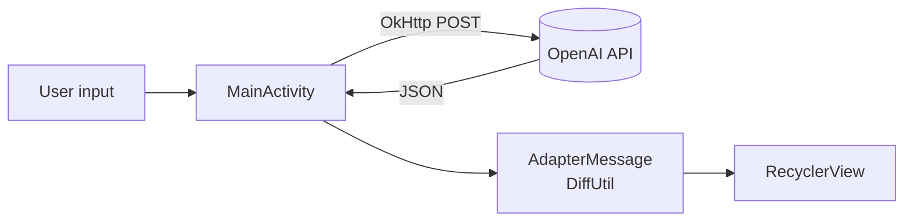

<p align="center">
  
</p>

  

A native Android chat client for the OpenAI API. Type a message, and the reply appears in a two-sided conversation, just like a messenger. Built with OkHttp directly — no SDK — to understand exactly what goes over the wire.

## Features

- **Messenger-style chat** — user messages on one side, AI replies on the other
- **Raw HTTP with OkHttp** — JSON request built by hand, asynchronous `enqueue` callback
- **`DiffUtil`-powered adapter** — only changed rows are redrawn
- **Auto-scroll** to the newest message (`stackFromEnd`)
- Readable error messages shown in the chat when a request fails

## How it works

Each message is a `ModelMessage(message, messageBy)`. `AdapterMessage` shows either the user layout or the AI layout depending on `messageBy`, and `submitData()` calculates a `DiffUtil` diff before updating.

The request is assembled as a `JSONObject`, sent with an `Authorization: Bearer …` header, and the reply is parsed from `choices[0]`.

The API key is **never stored in source** — it is read from `local.properties` into `BuildConfig` at build time.

## Architecture



## Project structure

```
com.example.chatgpt
├── model/
│   ├── ModelMessage.kt
├── ui/
│   ├── AdapterMessage.kt
│   ├── MainActivity.kt
├── utils/
│   ├── Constants.kt
```

<sub>4 source files · 201 lines of code · 2 layouts</sub>

## Tech stack

| | |
|---|---|
| **Language** | Kotlin |
| **UI** | XML layouts, View Binding |
| **Min / Target SDK** | 24 / 34 |
| **OkHttp** | HTTP / interceptors |

## Getting started

```bash
git clone https://github.com/rajabbov/ChatGPT.git
```

1. Open the folder in **Android Studio** (Ladybug or newer).
2. Let Gradle sync.
3. Complete the configuration below, then run the `app` configuration.

### Configuration

Add your key to `local.properties` (this file is git-ignored):

```properties
OPENAI_API_KEY=sk-...
```

## Known limitations

- The app targets the legacy `/v1/completions` endpoint with `text-davinci-003`, which OpenAI has retired. Moving to `/v1/chat/completions` with a current model is required for it to answer again.

---

Made by **Ibrohimjon Rajabboyev** · [@rajabbov](https://github.com/rajabbov)
